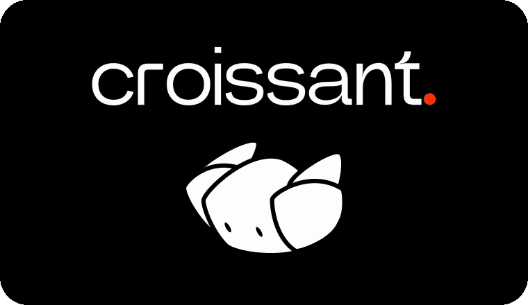
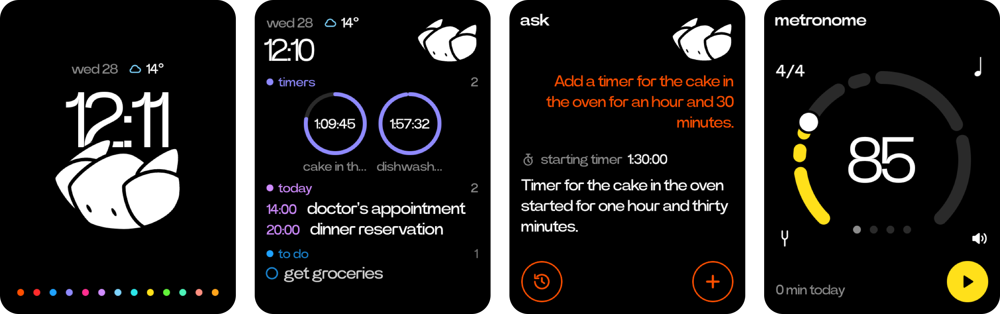

<p align="center">
  
</p>

<p align="center">
  Unlock your Rabbit R1 and turn it into the C1: a drop-in replacement for the stock OS that you can customize to your needs, and keep all your data private.
</p>

<p align="center">
  
</p>

Croissant replaces the R1's software with a LineageOS 20 GSI rooted with Magisk, `tailscaled` on the stock kernel, and one Kotlin/Compose app that is the whole device (Device Owner, home screen, lock task). Hold the side button and talk: your words are heard by Whisper on your own machine or by a cloud speech model, and Ask's model answers as text from the C1, on Ollama on your own machine or a cloud provider with your own key.

<p align="center">
  <a href="docs/features/ask.md"></a><a
  href="docs/features/recorder.md"></a><a
  href="docs/features/reminders.md"></a><a
  href="docs/features/timers.md"></a><a
  href="docs/features/camera.md"></a><a
  href="docs/features/calendar.md"></a><a
  href="docs/features/weather.md"></a><a
  href="docs/features/photos.md"></a><a
  href="docs/features/metronome.md"></a><a
  href="docs/features/translator.md"></a><a
  href="docs/features/agents.md"></a><a
  href="docs/features/atelier.md"></a><a
  href="docs/features/settings.md"></a>
</p>

## What you need

- An unlocked Rabbit R1.
- A Mac or Linux/WSL2 machine and a USB cable that carries data. The CLI brings
  [uv](https://docs.astral.sh/uv/) if needed, checks for what else it needs (on Linux a udev
  rule for the R1) and offers to install it.
- The app: a [release](#releases), or built from source, which needs Java 17+ and the
  Android SDK with NDK 28.2.13676358 (the installer offers both: Java through
  [SDKMAN!](https://sdkman.io)).
- A [Tailscale](https://tailscale.com/) tailnet. Highly recommended, not required (see
  [Network and security](#network-and-security)).
- A machine for the server, or a provider's API key instead ([Backend](#backend)). An
  Apple Silicon Mac runs Whisper and image generation locally. Elsewhere the server uses
  faster-whisper and provider APIs.
- Power Grotesk, the typeface. It is commercial (free for personal use), so the repo does
  not carry it. The installer gives you the
  [BeFonts](https://befonts.com/power-grotesk-font.html) link and asks for the downloaded
  zip. This specific font is not required, however _a_ font is for installing.

## Quickstart

1. In rabbithole, allow the unlock with the R1 on and online: settings > r1, void the
   warranty and enable developer mode, then settings > r1 > developer > device
   modification > unlock.
2. Install the `croissant` CLI (macOS or Linux):

   ```bash
   curl -fsSL https://github.com/emilienbev/croissant-c1/releases/latest/download/install.sh | sh
   ```

   It goes in `~/.croissant`, with uv if the machine has none, and `~/.croissant/bin` is added
   to the PATH in your shell's startup file ([installer/README.md](installer/README.md#installed-from-a-release)).
   `croissant upgrade` brings it to the latest release. Or use a checkout of this repo,
   where it is `./croissant`.
3. With the R1 on USB:

   ```bash
   croissant install
   ```

   It asks for what it needs (the font zip first, then which app: the latest release, or
   built from source), shows the plan, and tells you when to unplug or press something.
   About half an hour. Everything it downloads and keeps stays in `~/.croissant/cache` (in a
   checkout, its gitignored `cache/`), nowhere else on the machine.
4. On the machine that runs the server, if you use one ([Backend](#backend)):

   ```bash
   cd server
   uv run croissant-server
   ```

   The R1's first setup asks for Wi-Fi, your Tailscale login, the server (it finds it on
   the tailnet; skip it to run on cloud providers alone) and the time zone.
5. On the R1, Settings > ask: add a provider and its key under providers if you use one,
   then pick the models (with the server and Ollama, its defaults need no pick).

## Backend

- Ask runs on the C1: its prompt, its tools and every call to a chat model. Each model is
  picked in Settings > ask: chat, speech, pictures and the transform.
- The `croissant-server` is an optional helper on your own machine, shared by every C1 that
  uses it: Whisper for a hold's words (shown live while you hold; a cloud speech model
  gives them at the release), local pictures, and Ask's web search. Ollama beside it
  serves a local chat model.
- Without it, pick cloud models for chat, speech and pictures, skip the server step of the
  R1's first setup, and add each provider's key in Settings > ask > providers, typed on the
  R1 or on a phone (Settings > ask > on a phone). What still needs the server: the web
  search and the Mac's own models.

## Warnings

- Installing erases the R1.
- rabbit's unlock flow voids the warranty.
- The device is rooted, and adb stays open over USB.
- The server has no authentication. Keep it on your own tailnet
  ([Network and security](#network-and-security)).
- Croissant is not affiliated with or endorsed by rabbit inc.

## Releases

Each [release](https://github.com/emilienbev/croissant-c1/releases) carries the signed
app, `croissant-X.Y.Z.apk`, and its `.sha256`, and the CLI: `croissant-cli-X.Y.Z.tar.gz`, its
`.sha256` and the `install.sh` that installs it. To install an APK downloaded by hand:

```bash
shasum -a 256 -c croissant-X.Y.Z.apk.sha256
croissant install --apk croissant-X.Y.Z.apk
```

Or let the installer fetch and check the latest one: pick it when asked, or
`croissant install --apk latest` (the default for the CLI installed from a release).

The app, the server and the installer share one version, in `VERSION`.

## Updating

The C1 updates itself from its repository's releases (Settings > update). To put a chosen app on it by hand:

```bash
croissant app install croissant-X.Y.Z.apk                # an APK
croissant app install ~/Development/croissant-c1         # or built from a checkout of the source
```

An update must be signed with the same key as the install. Switching means uninstalling the app, which removes it as Device Owner.

The CLI itself: `croissant upgrade` (installed from a release), or `git pull` in a checkout.

## Network and security

- Tailscale is highly recommended, but not required. Without it, skip the R1's Tailscale step, start the server with `--host ADDR` on an address the R1 can reach, and type that address in the R1's server step.
- The server's own providers' keys (for its speech and pictures) are stored in `server/providers.json`, on the machine that runs `croissant-server`, and never reach the R1.
- Ask's providers and keys are the C1's (Settings > ask > providers), each key sealed by the Android keystore, sent only to its provider and shown only by its last four. They are typed on the R1 or on the page it serves to a phone (Settings > ask > on a phone): a QR code with a one-time code, up only while that page is open, on the tailnet's address when Tailscale is up. Plain Wi-Fi is offered too, and there what is typed crosses the network unencrypted: use it on a private network only.
- The R1's calls to the server are unauthenticated and go over plain HTTP. The default network setup relies on your tailnet being a closed, private network that only your own devices can join. On any other network setup, consider implementing your own authentication and encryption.

## Designs

The whole app supports themes and can be re-skinned. A design is its own package under
`ui/` that draws every screen over the same core, with its own variants (a palette, say),
picked live in Settings > Device > Design once there is more than one. Beam, shown above,
is the one that ships. Adding one: [android/README.md](android/README.md), "Adding a design".

## Atelier

Small apps anyone writes, a person or an agent, run on the C1 in Beam's own pieces: a
folder with `croissant.json` and `croissant.js`, added from a GitHub repository (typed or
scanned) or pushed from your computer with `./croissant atelier run`; `./croissant atelier
new` makes one to start from. The format and every call:
[docs/atelier.md](docs/atelier.md).

## Read more

- [installer/README.md](installer/README.md): every installer command and flag.
- [docs/atelier.md](docs/atelier.md): writing an Atelier app.
- [server/README.md](server/README.md): models, providers, flags.
- [android/README.md](android/README.md): building the app, Device Owner, code layout.
- [AGENTS.md](AGENTS.md): the rules for changing the code.

## Licence

Apache License 2.0, see [LICENSE](LICENSE). Third-party parts are listed in
[NOTICE](NOTICE).
