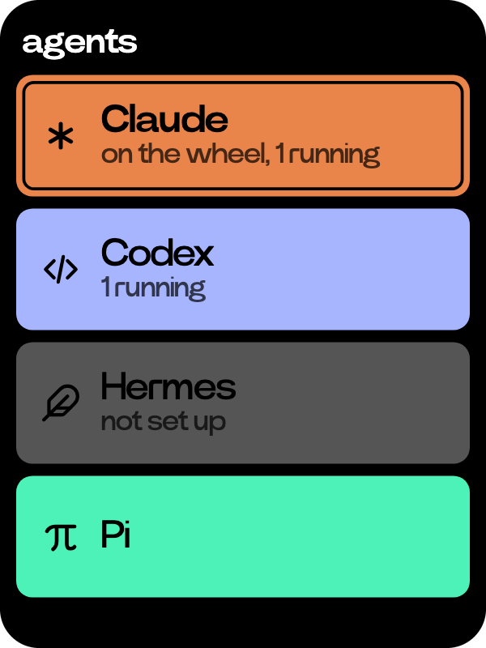
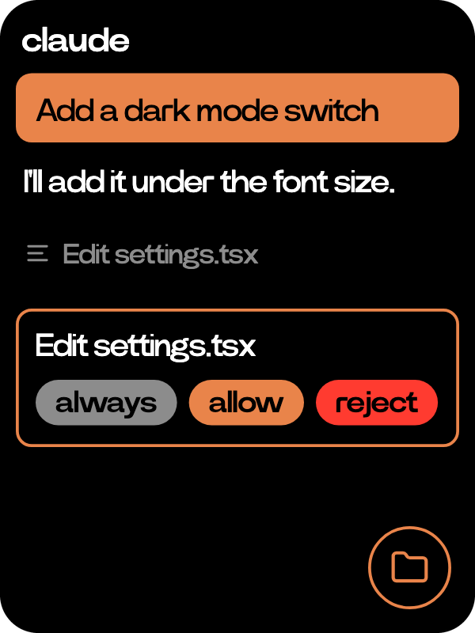

# Agents

  
  

Coding agents like Claude Code and Codex, running on your computer and driven from the C1.

- Start [acp-bridge](../../acp-bridge/README.md) on your computer with `acp-bridge serve`, then scan one of its QR codes with the scan key.
- Each agent is a card in its own colour, with its number of sessions. Tap one for its sessions by folder, newest first. A yellow dot means one is waiting on you. Press and hold a card to pin the agent to the wheel.
- Open a session or start a new chat, then hold the side button and talk. Your words are the agent's next prompt.
- The reply streams in, each tool call a line. When the agent asks before acting, tap an option like allow or reject. Stop ends the turn.
- The wheel scrolls. The folder key opens the session's folder on the computer, read only.
- Paired computers are listed under the cards. One is in use at a time.
