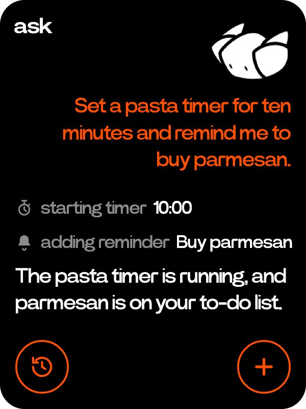
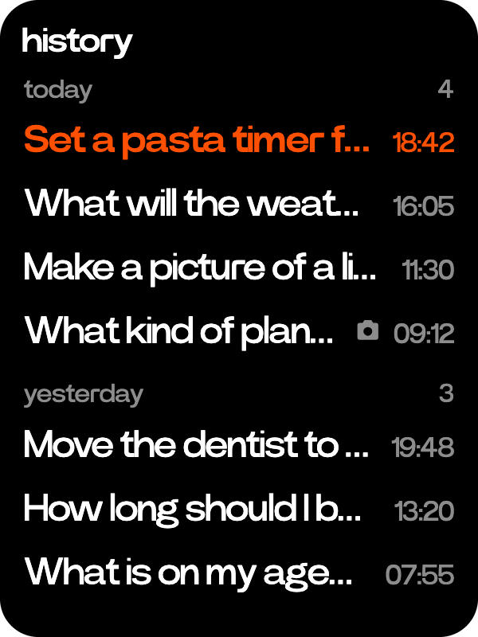

# Ask

  
  

A chat model on the side button. It answers in text and can do things on the C1 for you.

- Hold the side button anywhere and talk. The croissant listens while you hold and answers when you let go.
- Your words sit on the right in orange, the answer under them in white. The wheel scrolls back.
- Hold again to follow up. The plus key starts a new chat.
- The history key lists past chats by day. Tap one to carry on, or press and hold to pick some and delete them.
- The model is set in Settings > ask, from Ollama on your machine or a cloud provider with your own key.

Ask acts through tools, each call shown as a line with its feature's glyph.

| Tool | What it does |
|---|---|
| `agenda_list` `agenda_add` `agenda_update` `agenda_delete` | Reads and changes [reminders](reminders.md) and [events](calendar.md) |
| `timers_list` `timers_add` `timers_cancel` | Lists, starts and cancels [timers](timers.md) |
| `tape_ask` | Answers from a [tape](recorder.md)'s transcript |
| `web_search` | Searches the web, on the server |
| `image_generate` | Makes a picture for [Photos](photos.md), on the server |

[Atelier](atelier.md) apps add tools of their own.
