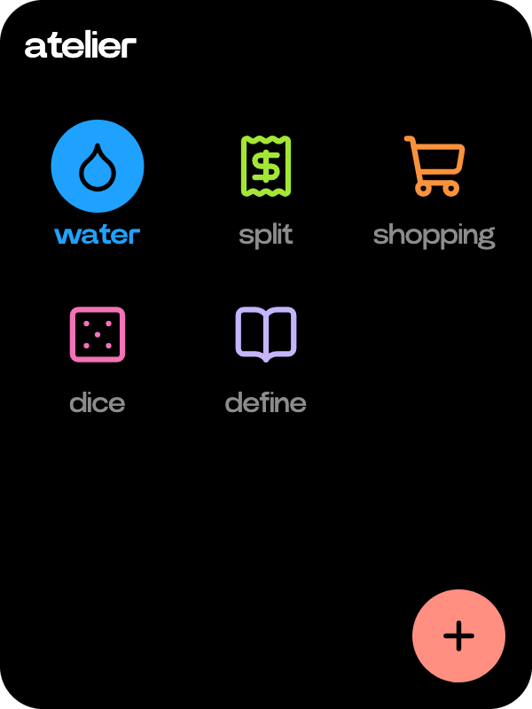
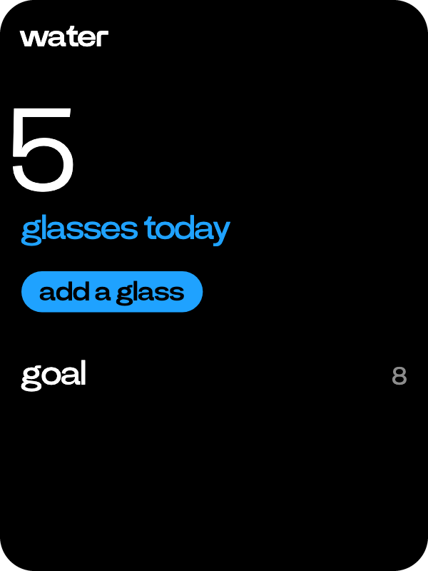

# Atelier

  
  

Small apps anyone can write, drawn in the C1's own design.

- Turn the wheel on Home to atelier and tap it. Each app has its place on the board, its glyph in its own colour. The wheel moves between them and a tap opens one.
- The plus key adds an app from GitHub. Type its owner/repo, or tap the scan key and point the camera at its QR code. Before you install it, the C1 shows where it comes from, that nobody has checked it, what it may use and what it adds to Ask.
- On an app's page the wheel moves between its rows, switches and keys. An app that takes your words gets what you say when you hold the side button there. It runs only while its page is open.
- An app can add tools to Ask, so you can use it from anywhere by asking. Its page comes up when Ask calls it.
- Press and hold an app to open its info, where you can pin it to the side wheel, turn it off or delete it.

To write an app of your own, see [Atelier apps](../atelier.md).
