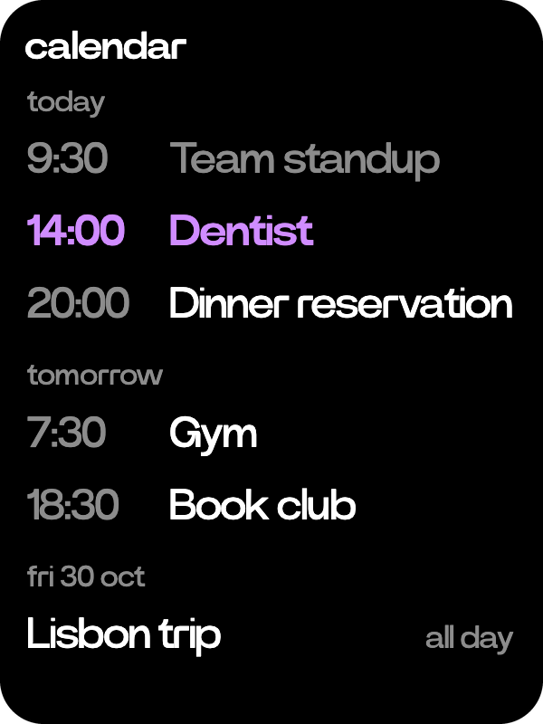
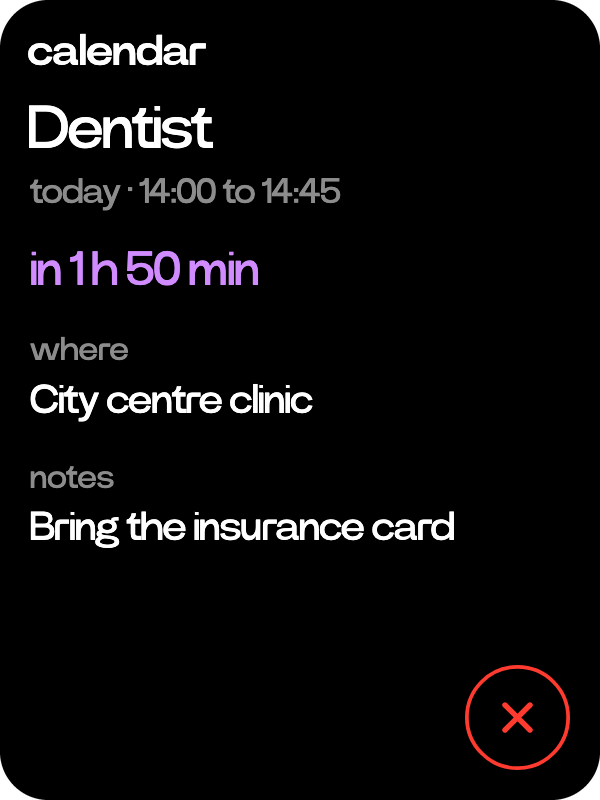

# Calendar

  
  

Your events from today on, added by asking.

- Turn the wheel on Home to calendar and tap it. To add an event, hold the side button and ask: "the dentist on Friday at two". A time makes a one-hour event, a day alone an all-day one. There is no add key on the page.
- Ask also moves an event, gives it an end, a place or notes, deletes it, and tells you what is coming up.
- Only the days with something show, under today, tomorrow or the date. What has ended today is in grey, and the list opens on the next event. The wheel moves between them and a tap opens one.
- An event's page says when it is, how long until it starts if that is today, and where and its notes when it has them. Tap the title to rename it. The red X deletes it, after a confirm.
- A tap on Home shows the next two events today, with the rest of your day.
