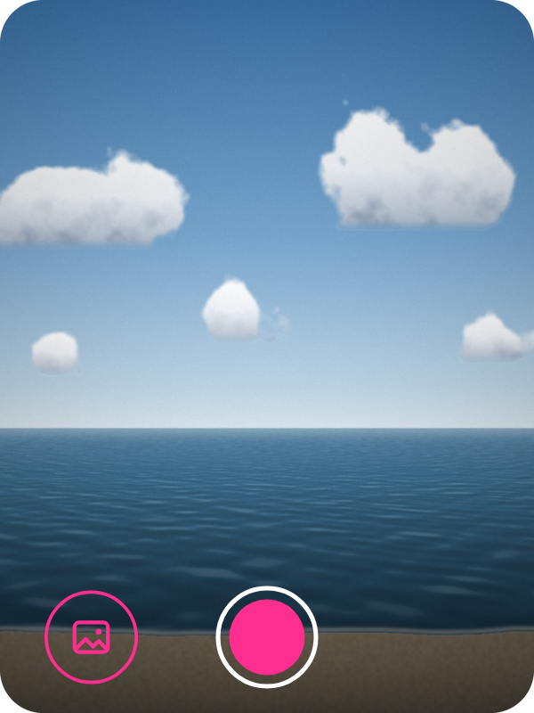
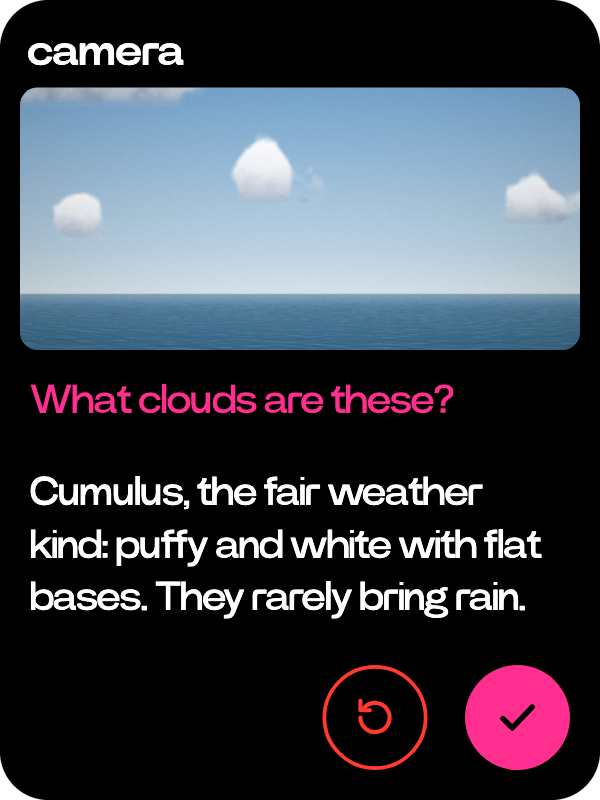

# Camera

  
  

Take a photo, or ask about what the camera sees.

- Two presses of the side button open it from anywhere, and two more close it.
- The side button or the shutter takes the photo. A double tap on the view flips to the front camera and back.
- The shot stays on screen. Hold the side button and ask about it: "what clouds are these?"
- The tick keeps the photo with your question. Retake throws it away.
- The bottom-left key opens Photos. Wheel up leaves the camera.
