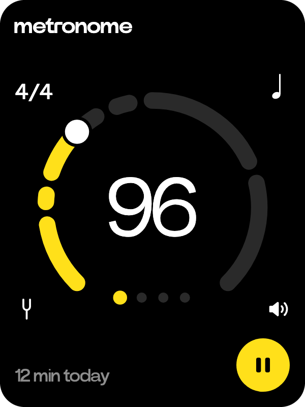
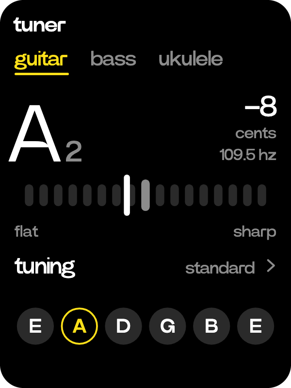

# Metronome

  
  

A metronome and a tuner.

- The play key starts and pauses it. The wheel sets the tempo, from 40 to 208. You can also drag round the ring or tap the middle in time.
- The dots light each beat, the first sounding higher and louder. Tap 4/4 for the time signature, the note for eighths, triplets or sixteenths, and the speaker for one of six sounds.
- Under the dial is how long you've played today, also on the side wheel. Tap it for the last five weeks.
- The tuning fork opens the tuner, for guitar, bass or ukulele. Play a string to see its note and how far off it is, in yellow within 3 cents. Tap a string to hold the tuner on it, and tap tuning for drop D, DADGAD and the others.
- The tuner only listens while its page is open.

> [!NOTE]
> For the tuner: The R1's microphone has trouble hearing a guitar or bass through the air. Stick the C1
> against the body of the instrument instead, as a clip-on tuner does with its piezo
> sensor, and it picks up the notes well.
