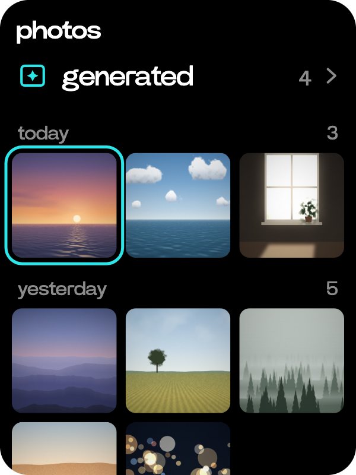
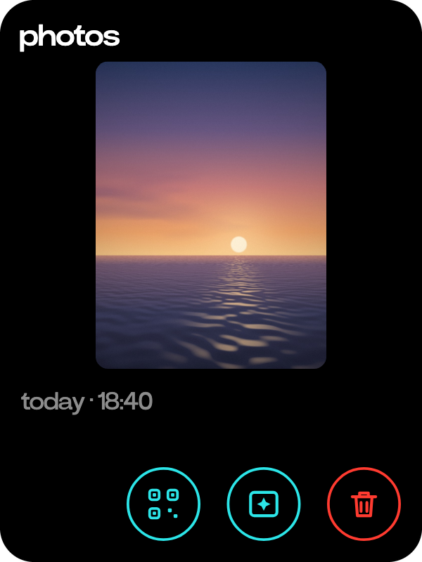

# Photos

  
  

The photos you keep, the pictures made for you, and a way to get them onto a phone.

- Turn the wheel on Home to photos and tap it, or tap the photos key on the camera.
- Your photos are listed by day, newest first, under generated. The wheel moves from one to the next and a tap opens it.
- A photo's page shows when it was taken and what you asked about it. Tap the picture to see it on the whole screen, or hold the side button to ask about it.
- The transform key, with the spark, makes a new picture from the photo. Hold the side button and say what you want, and it appears in generated. Ask makes one from words too: "draw a lighthouse at dusk".
- The send key shows a code. Scan it with a phone on the same wi-fi or tailnet and the photos open there.
- Press and hold a photo to pick it, tap others to pick them too, then send or delete them together. Delete asks first.
