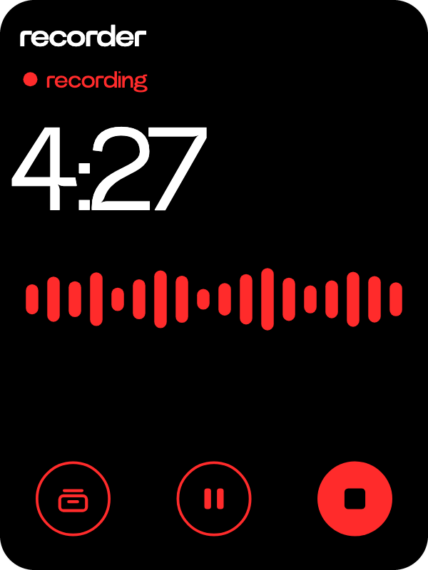
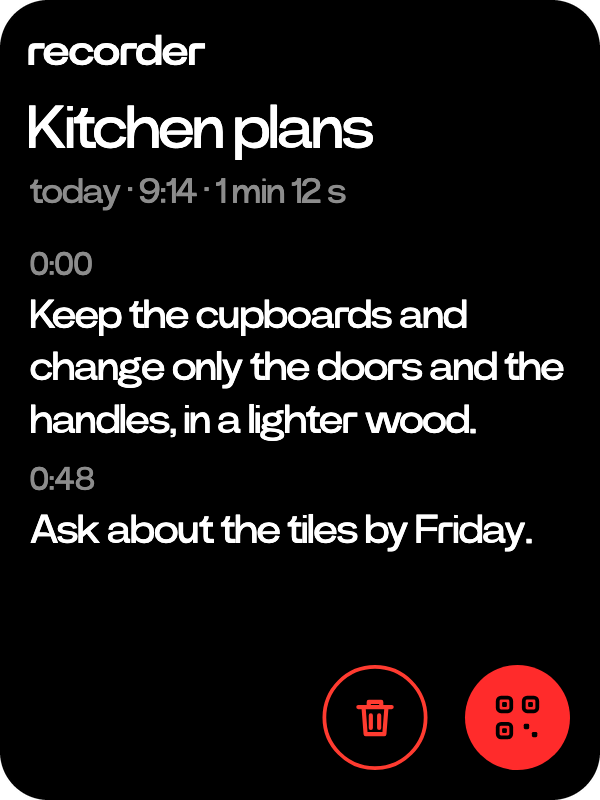

# Recorder

  
  

A voice recorder whose tapes can be turned into text.

- The middle key records. While recording it pauses, and the filled key on the right stops.
- Each take becomes a tape, Tape 1, Tape 2 and so on until you name it.
- The left key lists tapes by day, newest first, with their length.
- On a tape, tap the name to rename it. The lines key transcribes it with Whisper on your machine or a cloud speech model, in paragraphs marked with the time each starts. The bin deletes it after a confirm.
- Once transcribed, that key becomes send. It shows a code to read the transcript on your phone or save it as a text file.
- Recording keeps going while you use the rest of the C1, with its time on the side wheel.

Ask answers questions about a transcribed tape, named by its number or words of its title.

| You say | Ask calls |
|---|---|
| "what did I say about the tiles in kitchen plans?" | `tape_ask {"tape": "kitchen plans", "question": "what did I say about the tiles?"}` |
