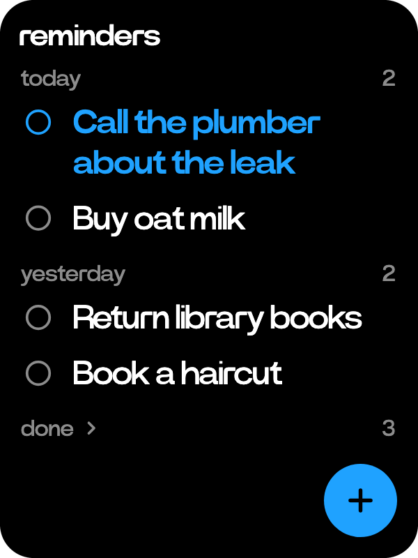
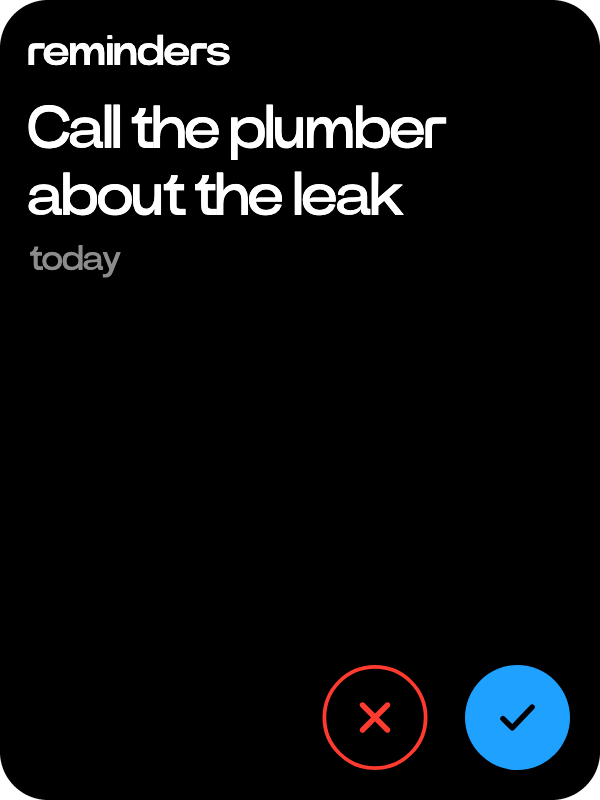

# Reminders

  
  

Things to do, with no day or time.

- The plus key adds one, typed on the keys.
- Reminders to do are listed under the day you added them, newest first. Ticked ones stay a week, folded under done.
- A reminder's page has a check key to tick it or put it back, and a red X to delete it after a confirm. Tap the title to rename it.
- Home shows the newest two under to do.

Ask uses one `agenda_add` tool for reminders and [events](calendar.md), and the date decides which you get. No day or time makes a reminder. A day makes an all-day event in Calendar, a time a one-hour one.

| You say | Ask calls | You get |
|---|---|---|
| "remind me to buy oat milk" | `agenda_add {"title": "buy oat milk"}` | a reminder |
| "remind me to call the bank tomorrow" | `agenda_add {"title": "call the bank", "at": "2026-10-30"}` | an all-day event |
| "the dentist on Monday at two" | `agenda_add {"title": "dentist", "at": "2026-11-02T14:00:00+01:00"}` | a one-hour event |

Give a reminder a day or time later and it becomes an event. Ask also reads, ticks off, renames and deletes reminders with `agenda_list`, `agenda_update` and `agenda_delete`.
