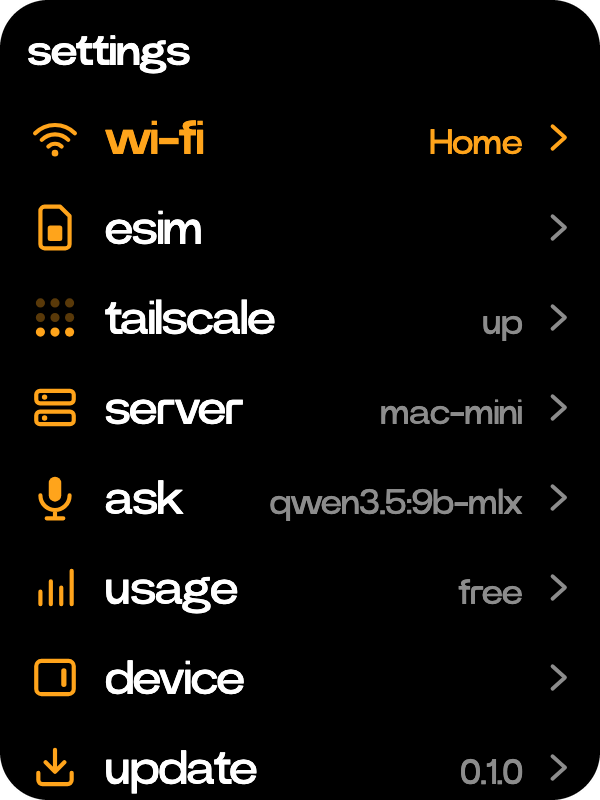
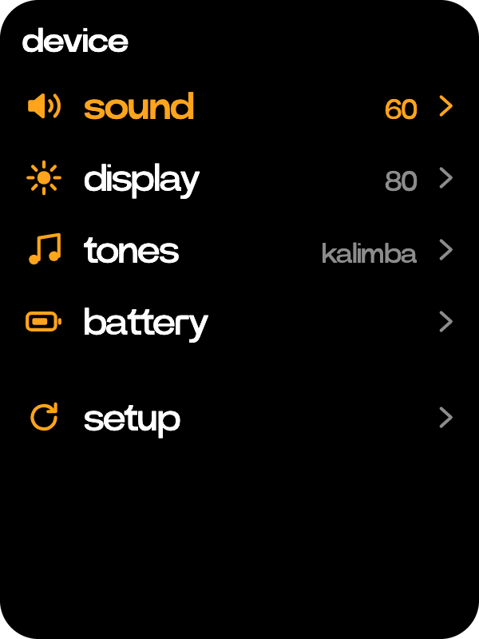

# Settings

  
  

Network, server, models and the device.

- **wi-fi** joins a network, with its password or by scanning its code.
- **esim** adds and switches profiles. **tailscale** signs in to your tailnet.
- **server** shows the computer the C1 talks to and what runs on it. Tap its card to pick another.
- **ask** picks Ask's model and prompt, providers, and the speech and picture models. **usage** shows what they cost over 30 days.
- **device** has sound, display, tones and battery. Its setup row runs the first setup again without wiping anything.
- **update** installs a new version of Croissant. **power** sleeps, restarts or powers off the C1.
