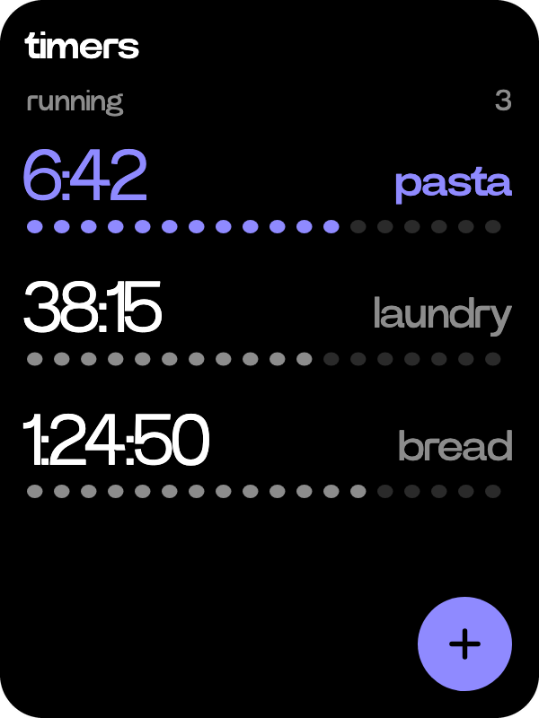
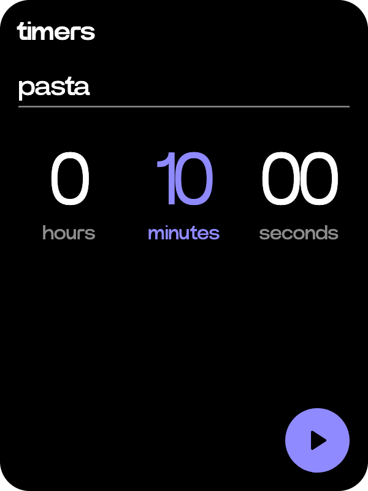

# Timers

  
  

Countdowns that keep running while you use the rest of the C1.

- Turn the wheel on Home to timers and tap it, or hold the side button and ask: "a ten minute timer for the pasta".
- The plus key opens a new timer. The wheel turns the column in lavender, minutes first. Tap another column to pick it, or drag up and down on it. Give it a name if you like, then press play.
- Every running timer is listed, the soonest first, with dots for the time it has left. The wheel moves between them.
- Tap a timer's name to rename it. Tap anywhere else on it to delete it, after a confirm.
- When a timer ends, the whole screen turns lavender and the croissant rings. A tap, the wheel or the side button stops it.
- A tap on Home shows the running timers too, as rings with the rest of your day.
