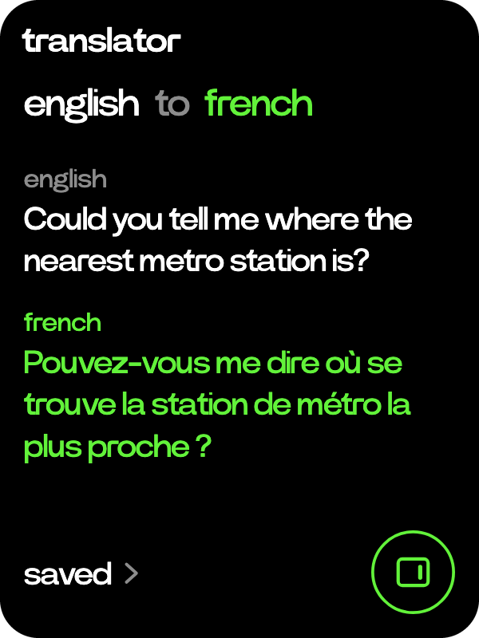
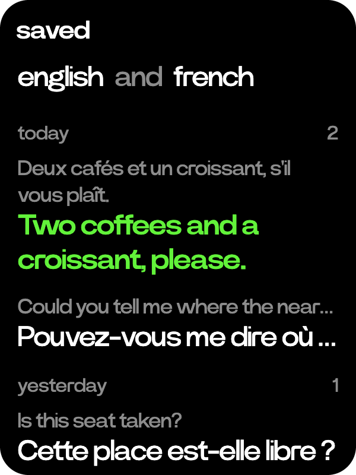

# Translator

  
  

Say something in one language and read it back in another.

- Turn the wheel on Home to translator and tap it. The wheel shows the pair it is set to.
- Hold the side button and talk. What you said comes in white under its language, the translation in green under the other. A hold here translates instead of going to Ask.
- Tap a language to pick another among english, french, german, italian, spanish and japanese. Tap "to" to turn the pair round.
- Every translation is kept. Tap saved, at the bottom left, to see them by day, both ways round. The wheel moves between them and shows the one in focus whole.
- The R1 key at the bottom right translates on the device itself, after a confirm, once its offline models are installed. Online is better, so keep it for an unstable network.
