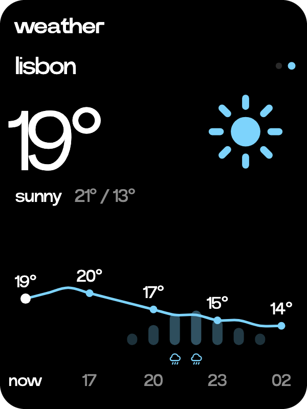
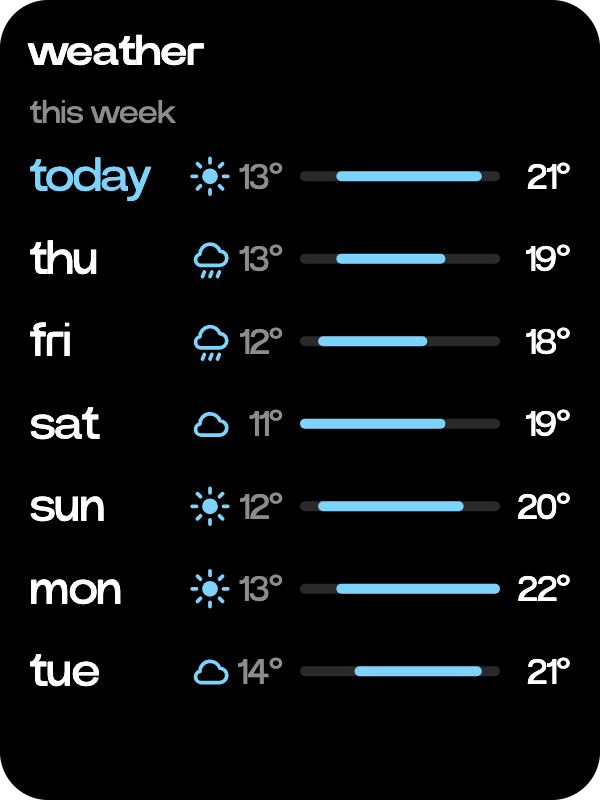

# Weather

  
  

The forecast where you are and for the places you add.

- Turn the wheel on Home to weather and tap it. It shows the temperature now with the sky, today's high and low, and the next twelve hours as a line with the chance of rain under it.
- Turn the wheel down for the week, each day's sky, low and high, and up to come back.
- The first place is here, from the C1's GPS. Swipe sideways for your other places, and the dots at the right say which one you are on.
- Tap the place's name for your places, and add a place to find one by name. Long press an added place to pin it to Home or remove it.
- Home shows the weather now beside the date, and the side wheel shows it under weather. Both show here, or the pinned place once the C1 has had no location for six hours.
- Forecasts come from Open-Meteo, every half hour while the C1 is awake.
